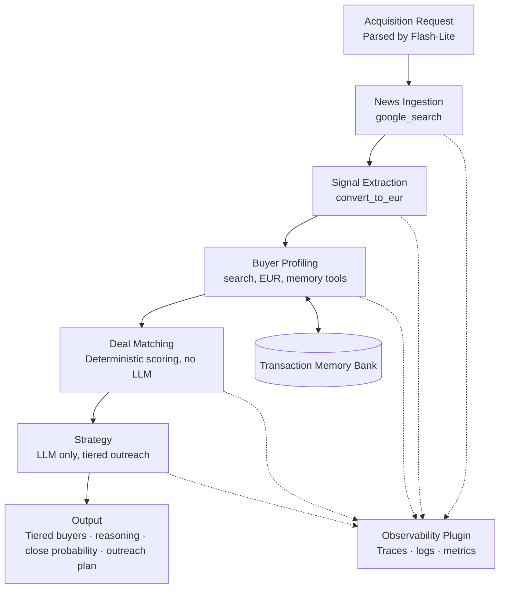

# M&A Signal Intelligence Engine

A multi-agent system turning fragmented M&A signals into actionable buyer intelligence, from data ingestion to strategic recommendations. Watch the Demo on **[YouTube](https://youtu.be/8YsdOT6R3fs)**

> ** Agents for Business - AI Agents: Intensive Vibe Coding Capstone Project

## Why It Matters

Deals rarely fail for lack of buyers. They fail because teams call the wrong buyers at the wrong time, working from static relationship maps and missing live signals like leverage events, divestments and strategic pivots. The M&A Signal Intelligence Engine, a sequential multi-agent system built with Google ADK and Gemini 2.5 Flash, reads those signals and answers one question: "Who is actually likely to buy this company right now and why?"

## Value for M&A Teams

| Outcome | Description |
|---|---|
| **Buyer Relevance** | Improved accuracy in identifying the right acquirers for each asset |
| **Deal Close Probability** | Higher competitive tension through better buyer targeting |
| **Noise Reduction** | Fewer irrelevant outreach contacts wasting deal team bandwidth |
| **Decision Intelligence** | Unstructured news transformed into structured, decision-grade output |

## Quick Start

### Prerequisites

- **Python 3.10+** (developed on 3.11)
- A **Gemini API key** from [Google AI Studio](https://aistudio.google.com/apikey)

### 1. Clone & enter

```bash
git clone https://github.com/YOUR_USERNAME/ma-signal-intelligence-agent.git
cd ma-signal-intelligence-agent
```

### 2. Virtual environment

```bash
python3 -m venv .venv
source .venv/bin/activate        # macOS / Linux
# .venv\Scripts\activate         # Windows
```

### 3. Install dependencies

```bash
pip install -r requirements.txt
```

### 4. Configure your API key

```bash
cp .env.template orchestrator/.env
# then edit orchestrator/.env and paste your key:
#   GOOGLE_API_KEY="your_gemini_api_key_here"
```

> **Security:** `orchestrator/.env` is git-ignored — never commit your key.

### 5. Run the pipeline

```bash
# Interactive (no quotes needed):
python3 run.py
#   → Describe the acquisition target (or press Enter for the built-in example):
#   > 500MW solar PV portfolio in Spain

# One-shot (quotes required):
python3 run.py "Find buyers for a distressed German fiber-optic company"
```

**Expected terminal output:**

```
---------------------------------------------------------
M&A SIGNAL INTELLIGENCE ENGINE - PIPELINE SUMMARY
---------------------------------------------------------
Run ID  : run_XXXXXXXX_XXXXXX
Target  : 500MW Solar PV Portfolio
---------------------------------------------------------
  Agent 1 - News Ingestion            signals retrieved
  Agent 2 - Signal Extraction         events classified
  Agent 3 - Buyer Profiling           XX buyer profiles built
  Agent 4 - Deal Matching             XX buyers scored (XX excluded)
    Top buyer: XXX (score: X.X)
  Agent 5 - Strategy                  recommendation generated
---------------------------------------------------------
Google Search calls           XX
Total latency                 XXXXXXms
---------------------------------------------------------
```

After each run, a full trace is saved to `observability/logs/full_trace.json`, and precedent deals accumulate in `memory/transactions.json`.

## Architecture



## Project Structure

```
ma-signal-intelligence-agent/
│
├── run.py                          ← Entry point (interactive + CLI; Flash-Lite request extraction)
├── requirements.txt                ← Python dependencies
├── .env.template                   ← Copy to orchestrator/.env, then add your key
├── .gitignore
├── LICENSE                         ← Apache License 2.0 (full text)
│
├── orchestrator/
│   ├── __init__.py
│   ├── agent.py                    ← SequentialAgent + App + Runner + SessionService + plugin + compaction
│   ├── compaction.py               ← TruncatingSummarizer (deterministic context compaction, no LLM)
│   └── .env                        ← API key (git-ignored)
│
├── agents/                         ← Individual agent definitions
│   ├── __init__.py
│   ├── _gate.py                    ← Cost gate (skips dead-end model calls)
│   ├── news_ingestion_agent.py     ← Agent 1: google_search
│   ├── signal_extraction_agent.py  ← Agent 2: M&A signal classification (convert_to_eur)
│   ├── buyer_profiling_agent.py    ← Agent 3: buyer profiles + memory (search/save) + retry loop
│   ├── deal_matching_agent.py      ← Agent 4: deterministic scoring (no LLM)
│   └── strategy_agent.py           ← Agent 5: tiered outreach strategy
│
├── tools/                          ← Custom tool definitions
│   ├── __init__.py
│   ├── buyer_scoring_tool.py       ← Weighted match score + hard exclusion rules
│   └── currency_tool.py            ← Live EUR conversion via ECB daily reference rates
│
├── skills/                         ← Shared prompt utilities
│   ├── __init__.py
│   └── anti_hallucination.py       ← Parametric anti-hallucination rules appended to LLM agents
│
├── memory/                         ← Long-term precedent-deal memory
│   ├── __init__.py
│   ├── transaction_store.py        ← save_transaction / search_transactions (JSON persistence)
│   └── transactions.json           ← Accumulated precedent deals (auto-generated)
│
├── observability/                  ← Logging, tracing, metrics
│   ├── __init__.py
│   ├── tracer.py                   ← PipelineTracer: logging · tracing · metrics
│   ├── tracing_plugin.py           ← ADK plugin wiring the tracer to the App
│   └── logs/full_trace.json        ← Full decision trace per run (auto-generated)
│
├── evals/                          ← Evaluation suite
│   ├── eval_scoring.py             ← Deterministic scoring (no model)
│   ├── eval_parser.py              ← JSON parser robustness (no model)
│   ├── eval_memory.py              ← Long-term memory round-trip (no model)
│   ├── eval_extraction.py          ← Prompt → target extraction (Flash-Lite)
│   └── results/                    ← Timestamped JSON evidence + history.md
│
└── docs/
    ├── user_guide.md               ← Full usage guide
    ├── sample_run.md               ← Annotated end-to-end example run
    └── glossary.md                 ← M&A and pipeline terminology
```

## Course Concepts Demonstrated (6 of 8)

**1. Multi-Agent Systems** ✅
- 4 LLM agents (`news_ingestion`, `signal_extraction`, `buyer_profiling`, `strategy`)
- 1 custom agent (`DealMatchingAgent` – deterministic `BaseAgent`, no LLM)
- 2 workflow agents (`ma_signal_intelligence_engine` – `SequentialAgent` orchestrating the pipeline; `buyer_profiling_loop` – `LoopAgent` that retries buyer profiling once if a flaky model turn returns empty output)

**2. Tools** ✅
- **Built-in:** `google_search` (real-time M&A news and buyer financial data)
- **Custom (`FunctionTool`):** `convert_to_eur` (live EUR conversion via ECB reference rates), `score_buyer` / `rank_buyers` (deterministic scoring), `save_transaction` / `search_transactions` (memory bank)

**3. Sessions & Memory** ✅
- `InMemorySessionService` + inter-agent state (`output_key`, `EventActions state_delta`, prompt injection)
- **Long-term memory:** `transaction_store.py` persists precedent deals across runs

**4. Context engineering** ✅
- **Context compaction:** deterministic context compaction (`TruncatingSummarizer` via `EventsCompactionConfig`)

**5. Observability** ✅
- Logging · Tracing · Metrics via `PipelineTracer`, wired as an `App` plugin; full trace JSON per run

**6. Agent Evaluation** ✅
- 4-script eval suite (3 offline + 1 model-based) with timestamped, saved evidence

> **Minimum requirement: 3 concepts vs. implemented: 6 ✅**

## 📄 License

Copyright © 2026 Olga Aksenova.

The code in this repository is licensed under the **[Apache License, Version 2.0](https://www.apache.org/licenses/LICENSE-2.0)** – see
[LICENSE](LICENSE) for the full text.

*Built for AI Agents: Intensive Vibe Coding Capstone Project*
